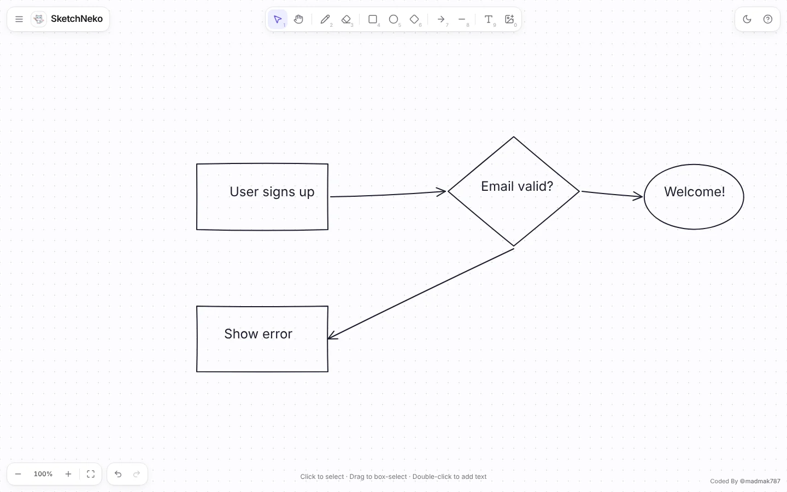

# SketchNeko

A hand-drawn style whiteboard by [Mohd Amir Khan](https://khanamir.me). Sketch diagrams, wireframes and notes with shapes, arrows, freehand, text and images, then export to PNG or SVG. Everything runs in the browser and is saved to local storage — no accounts, no server.

Live: **https://tool.khanamir.me/sketch**



## Run locally

```bash
npm install
npm run dev
```

Open [http://localhost:3000](http://localhost:3000). Locally the app runs at `/`; the `/sketch` base path is only applied in CI.

Production build (static export to `out/`):

```bash
NEXT_PUBLIC_APP_URL=https://tool.khanamir.me/sketch npm run build
```

`postbuild` writes `out/.htaccess` (404 page, caching, compression) for Hostinger.

## Deploy

GitHub Actions on `main` / `master` / `production` builds the static site with `NEXT_PUBLIC_APP_URL=https://tool.khanamir.me/sketch` and uploads `out/` over FTPS to `/public_html/tool/sketch/` (served as https://tool.khanamir.me/sketch). The `FTP_SERVER`, `FTP_USERNAME` and `FTP_PASSWORD` repository secrets come from `~/.config/deploy/hostinger-ftp.env`:

```bash
gh secret set -f ~/.config/deploy/hostinger-ftp.env -R madmak787/SketchNeko
```

With that login the FTP top level contains `public_html/`, so every path must start with `/public_html`. It can also be run manually from the Actions tab (**Build & Deploy SketchNeko**).

`public/module_info.json` and `public/thumbnail.png` describe the tool for the catalog on tool.khanamir.me.
